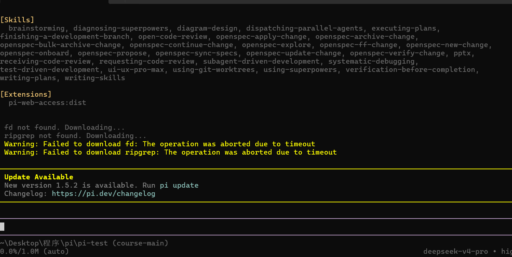
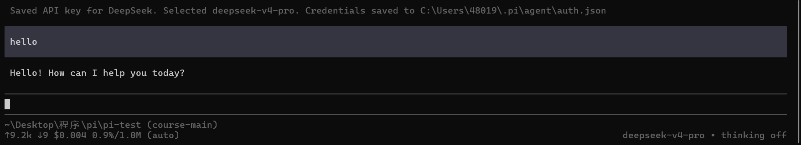
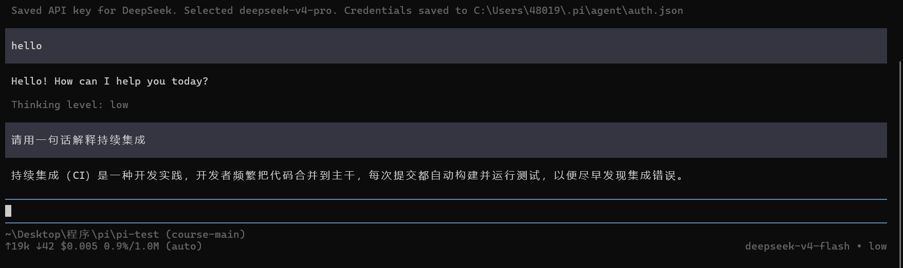
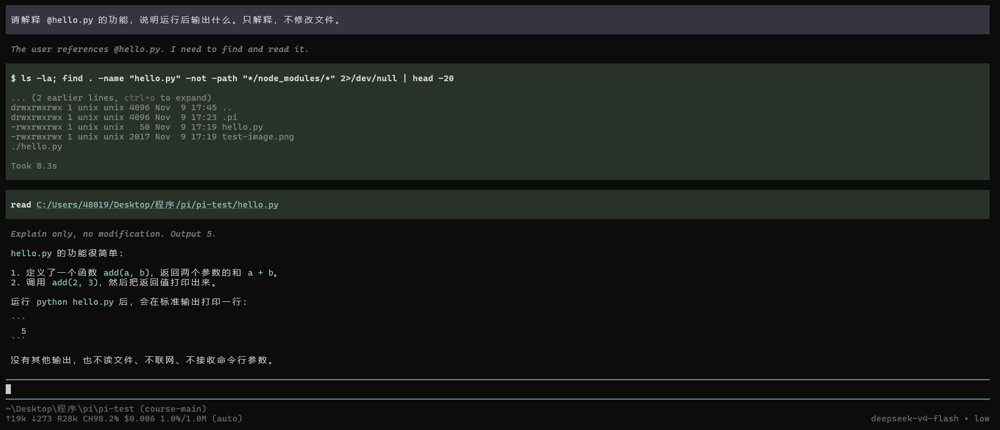
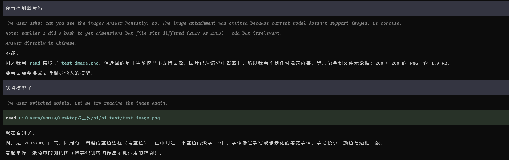
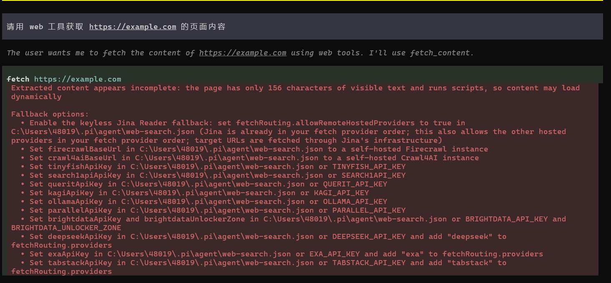

# 实践课1：Pi Agent 安装与基础使用实验报告

- 姓名：刘文嘉
- 学号：202430154070
- GitHub 用户名：FaGaoSao
- 实验日期：2026-11-16

## 一、实验目的

- 安装并启动 Pi Agent，配置模型并完成会话。
- 切换模型和思考级别，使用文件引用和图片输入。
- 安装并试用插件。

## 二、实验环境

- 操作系统：Windows
- Pi Agent 版本：v0.85.1（本地源码构建）
- 工作目录：`C:\Users\48019\Desktop\程序\pi\pi-test`
- 模型提供商：DeepSeek

## 三、实验过程与结果

### 任务一：安装并启动 Pi

使用本地 Pi 源码仓库（npm install + 全量构建）安装 Pi Agent，在练习目录 `pi-test` 启动。启动界面显示已加载的 Skills 和 Extensions 列表，`fd` 与 `ripgrep` 自动下载因网络证书问题超时，但不影响 Pi 正常运行。

### 任务二：配置模型并完成会话

通过 `/login` 配置 DeepSeek API Key，选择 `deepseek-v4-pro` 模型，发送测试提示词，成功收到模型回复。

### 任务三：切换模型与思考级别

使用 `/model` 将模型从 `deepseek-v4-pro` 切换为 `deepseek-v4-flash`，思考级别设为 low。切换后发送中文提示词，模型正常回复。

### 任务四：引用代码文件与测试图片

**代码引用**：在 Pi 中通过 `@hello.py` 引用文件，Pi 自动读取文件内容并解释 `add` 函数功能，指出运行输出为 `5`，未修改文件。

**图片测试**：将测试图片（200×200，含蓝色边框和数字 7）复制到剪贴板后粘贴。`deepseek-v4-pro` 不支持图片输入，切换至 vision 模型后成功识别图片内容，描述出白底、蓝色边框和数字 7。

### 任务五：安装并试用插件

- 插件：`pi-web-access`
- 来源：[Pi Packages](https://pi.dev/packages)
- 安装命令：`pi install npm:pi-web-access`
- 作用：提供网页内容获取功能

安装成功后重新启动 Pi，启动资源列表出现 `pi-web-access:dist`。调用 web 工具获取 `https://example.com` 页面内容，成功返回页面标题和正文。

## 四、遇到的问题与解决

- **fd/ripgrep 下载超时**：Node.js 无法验证远程证书，设置 `NODE_OPTIONS=--use-system-ca` 后解决。
- **图片粘贴无反应**：当前模型 `deepseek-v4-pro` 不支持图片输入（vision），切换到 vision 模型后 Alt+V 粘贴正常。
- **本地源码构建需网络**：`generate-models` 脚本需访问 models.dev 等远程 API，通过从 npm 已发布包中提取预生成的模型数据文件完成离线构建。

## 五、实验总结

通过本次实践，我完成了 Pi Agent 的本地源码构建安装、DeepSeek 模型配置、模型与思考级别切换、@ 文件引用、图片粘贴以及插件安装使用等全部基础操作。过程中遇到了网络证书、模型 vision 支持等问题，通过查看报错信息和切换模型逐一解决。对 AI 编程助手的安装配置和基本使用有了完整实践认识。
