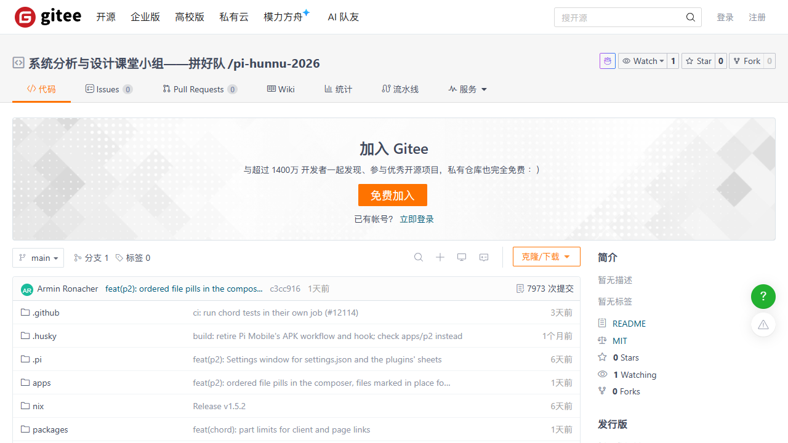
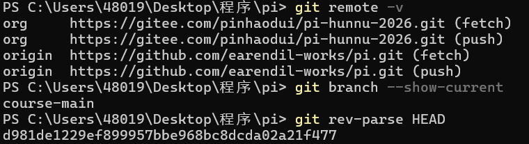
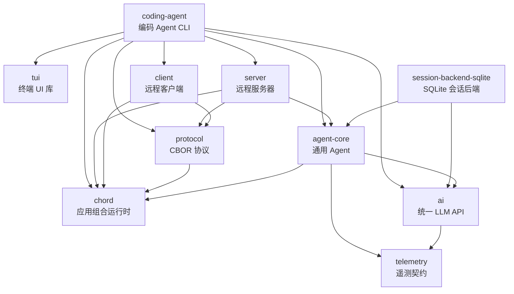
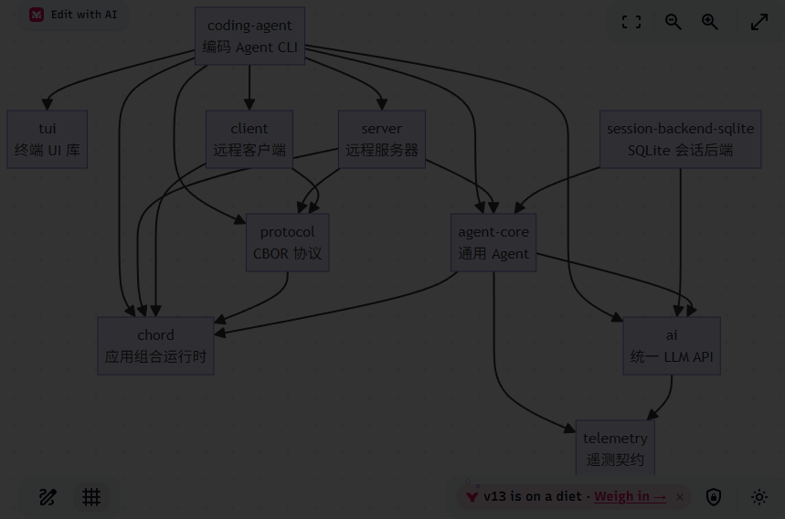

# 实践课2：组织建仓与源码分析实验报告

- 姓名：刘文佳
- 学号：202430154070
- GitHub 用户名：FaGaoSao
- 实验日期：2026-11-16
- 小组组织：拼好队（pinhaodui）
- 小组仓库：https://gitee.com/pinhaodui/pi-hunnu-2026

## 一、源码获取

### 1.1 小组组织仓库

组长将课程仓库 `hunnuOpenSourceSoftware2026/pi-hunnu-2026` fork 到小组 Gitee 组织 `pinhaodui`，仓库地址：

```
https://gitee.com/pinhaodui/pi-hunnu-2026
```



### 1.2 本人 clone 后的仓库信息

```
C:\Users\48019\Desktop\程序\pi> git remote -v
org    https://gitee.com/pinhaodui/pi-hunnu-2026.git (fetch)
org    https://gitee.com/pinhaodui/pi-hunnu-2026.git (push)
origin https://github.com/earendil-works/pi.git (fetch)
origin https://github.com/earendil-works/pi.git (push)

C:\Users\48019\Desktop\程序\pi> git branch --show-current
course-main

C:\Users\48019\Desktop\程序\pi> git rev-parse HEAD
d981de1229ef899957bbe968bc8dcda02a21f477
```



本人重点分析的模块：**coding-agent**（编码 Agent CLI，项目顶层入口）和 **chord**（应用组合运行时，被最多模块依赖的底层包）。

## 二、模块分析

### 2.1 版本差异说明

指导书列出的 11 个模块为 `telemetry、schema、chord、tui、codemode、mcp、ai、durable、env、agent、coding-agent`。本人使用的版本（commit d981de1）实际包含的包为：`chord、tui、telemetry、ai、agent-core、session-backend-sqlite-node、protocol、client、server、coding-agent`。

差异：
- 指导书中的 `schema`、`codemode`、`mcp`、`durable`、`env` 在本版本中不存在（可能是后续版本拆分或合并的模块）。
- 本版本新增了 `session-backend-sqlite-node`（SQLite 会话持久化）、`protocol`（CBOR 传输协议）、`client`（远程会话客户端）、`server`（远程会话服务器）四个包，用于支持 Pi 的远程会话功能。

以下分析以实际代码为准。

### 2.2 模块分析表

| 子文件夹 | 代码主要实现什么功能 | 本模块 build 执行什么、生成什么 | 直接依赖哪些内部模块 | 依据文件或代码位置 |
|----------|---------------------|-------------------------------|---------------------|-------------------|
| **chord** | 应用组合运行时：服务注册、复制状态管理、RPC 调用、插件加载。提供 `Context`、`Delta`、`Facets`、`Services` 等核心抽象，是 Pi 各组件的底层骨架 | `tsgo -p tsconfig.build.json`，将 TypeScript 编译为 ESM JS 到 `dist/`，生成 `.d.ts` 类型声明 | 无（最底层包） | `packages/chord/src/index.ts`、`packages/chord/src/services/`、`packages/chord/src/context/` |
| **tui** | 终端用户界面库：差分渲染（diff rendering）、键位绑定、编辑器组件、自动补全、模糊搜索、终端颜色/图片、替代屏幕模式 | `tsgo -p tsconfig.build.json`，编译为 ESM JS + 类型声明到 `dist/` | 无 | `packages/tui/src/index.ts`、`packages/tui/src/layout.ts`、`packages/tui/src/keybindings.ts`、`packages/tui/src/components/` |
| **telemetry** | 厂商中立的遥测契约和类型化 schema 工具：定义事件类型、提供 `MemoryTransport`（内存）和 `NoopTransport`（空实现）两个基础传输 | `tsgo -p tsconfig.build.json`，编译为 ESM JS + 类型声明到 `dist/` | 无 | `packages/telemetry/src/index.ts`、`packages/telemetry/src/memory.ts`、`packages/telemetry/src/noop.ts` |
| **ai** | 统一 LLM API 层：自动模型发现（从 models.dev、OpenRouter、Vercel AI Gateway 拉取）、多 provider 适配（OpenAI、Anthropic、Google、DeepSeek 等 39 个 provider）、推理等级映射、OAuth 认证、图像生成 API | `npm run generate-models && npm run build:offline`：先从网络拉取最新模型目录生成 `models.generated.ts` 和 `src/providers/data/*.json`，再编译为 ESM JS + 类型声明到 `dist/`，并复制 provider data | **telemetry** | `packages/ai/src/index.ts`、`packages/ai/src/models.generated.ts`、`packages/ai/src/providers/`、`packages/ai/package.json`（dependencies） |
| **agent-core** | 通用 Agent 核心：Agent 循环（`agent-loop.ts`）、传输抽象、状态管理、附件支持、搜索（`search/`）、代理（`proxy.ts`）、流式处理（`stream-fn.ts`）、harness 框架 | `tsgo -p tsconfig.build.json`，编译为 ESM JS + 类型声明到 `dist/` | **chord、ai、telemetry** | `packages/agent/src/agent.ts`、`packages/agent/src/agent-loop.ts`、`packages/agent/src/harness/`、`packages/agent/package.json` |
| **session-backend-sqlite-node** | Node.js SQLite 会话持久化后端：为 agent-core 的会话提供本地数据库存储，包含迁移脚本（`copy-migrations.mjs`） | `tsgo -p tsconfig.build.json && node scripts/copy-migrations.mjs`：编译 + 复制数据库迁移文件到 `dist/` | **ai、agent-core** | `packages/session-backends/sqlite-node/package.json`、`packages/session-backends/sqlite-node/scripts/copy-migrations.mjs` |
| **protocol** | 传输中立的 CBOR 序列化协议：定义远程 Pi 会话的消息格式、编解码（`codec.ts`）、帧化（`framing.ts`） | `tsgo -p tsconfig.build.json`，编译为 ESM JS + 类型声明到 `dist/` | **chord** | `packages/protocol/src/protocol.ts`、`packages/protocol/src/codec.ts`、`packages/protocol/src/framing.ts` |
| **client** | 传输中立的远程 Pi 会话客户端：连接管理（`connection.ts`）、帧化 CBOR 字节流传输（`transport.ts`）、Promise 封装、Unix socket 支持 | `tsgo -p tsconfig.build.json`，编译为 ESM JS + 类型声明到 `dist/` | **chord、protocol** | `packages/client/src/client.ts`、`packages/client/src/connection.ts`、`packages/client/src/transport.ts` |
| **server** | 实验性远程 Pi 会话服务器：会话路由（`session-router.ts`）、连接管理、监听器、多种传输方式（TCP、Unix socket） | `tsgo -p tsconfig.build.json`，编译为 ESM JS + 类型声明到 `dist/` | **chord、agent-core、protocol** | `packages/server/src/server.ts`、`packages/server/src/session-router.ts`、`packages/server/src/transports/` |
| **coding-agent** | 编码 Agent CLI（项目顶层入口）：read/bash/edit/write/grep/find/ls 等工具、交互式 TUI 模式和 RPC 模式、扩展系统、会话管理、认证流程、包管理器、HTML 导出、压缩（compaction） | `npm run build:unbundled && node ../../scripts/build-coding-agent-bundle.mjs`：先编译未打包版本，再用打包脚本生成独立可执行 bundle | **chord、agent-core、ai、tui、client、protocol、server**（依赖全部 7 个内部运行时包） | `packages/coding-agent/src/cli.ts`、`packages/coding-agent/src/modes/`、`packages/coding-agent/src/core/tools/`、`packages/coding-agent/package.json` |

### 2.3 模块依赖关系图

箭头方向：**使用方 → 被依赖方**。





图源文件：[dependency-graph.mmd](dependency-graph.mmd)（Mermaid 格式，可用 mermaid.live 或 VS Code Mermaid 插件渲染）

**层级划分依据：**

- **L0（无内部依赖）**：chord、tui、telemetry —— 三个基础库，不依赖任何其他 Pi 包
- **L1（依赖 L0）**：ai（依赖 telemetry）、protocol（依赖 chord）
- **L2（依赖 L0-L1）**：agent-core（依赖 chord、ai、telemetry）、client（依赖 chord、protocol）
- **L3（依赖 L0-L2）**：sqlite-node（依赖 ai、agent-core）、server（依赖 chord、agent-core、protocol）
- **L4（顶层入口）**：coding-agent（依赖全部 7 个 L0-L3 运行时包）

### 2.4 构建问题回答

**Q1：根目录与子模块中的 `npm run build` 分别读取什么配置、执行什么工作？**

根目录 `package.json` 的 `build` 脚本是一条串行命令链，按依赖顺序依次 `cd` 到每个包的目录执行 `npm run build`。它不读取单独的构建配置文件，而是依赖每个子包的 `package.json` 中的 `build` 脚本定义。

各子模块的 `build` 脚本读取各自的 `tsconfig.build.json`（基于根目录 `tsconfig.base.json`），执行 TypeScript 编译器（`tsgo`，即 TypeScript 7 原生编译器）将 `src/` 下的 `.ts` 文件编译为 `dist/` 下的 `.js` + `.d.ts`。特殊包：
- `ai`：build 先执行 `generate-models`（网络拉取模型目录）再 `build:offline`（编译 + 复制 provider data）
- `sqlite-node`：build 额外执行 `copy-migrations.mjs` 复制数据库迁移文件
- `coding-agent`：build 执行 `build:unbundled`（编译未打包版本）再 `build-coding-agent-bundle.mjs`（打包为独立可执行文件）

**Q2：构建顺序和模块依赖有什么关系？相邻构建的模块是否一定互相依赖？**

构建顺序严格遵循依赖拓扑序：被依赖的包先构建，依赖方后构建。例如 chord（L0）在 agent-core（L2）之前构建，ai（L1）在 agent-core 之前构建。这确保每个包编译时，它依赖的内部包已有可用的 `dist/` 产物。

相邻构建的模块**不一定**互相依赖。例如构建顺序中 `tui` 和 `telemetry` 相邻，但 tui 不依赖 telemetry，telemetry 也不依赖 tui——它们只是同为 L0 基础包，彼此独立。相邻仅表示在串行构建链中的先后位置，不代表直接依赖关系。

**Q3：选择一条涉及至少三个模块的依赖路径，说明这些模块如何分工。**

路径：**coding-agent → agent-core → ai → telemetry**

- **coding-agent**（顶层入口）：负责 CLI 解析、交互式 TUI 渲染、工具执行（read/bash/edit/write）、扩展加载、会话管理。它不直接实现 LLM 调用，而是通过 agent-core 的 Agent 循环驱动对话。
- **agent-core**（Agent 核心）：实现通用的 Agent 循环（`agent-loop.ts`），管理消息状态、工具调用分发、流式响应处理。它不直接对接具体 LLM provider，而是通过 ai 包的统一 API 发起模型请求。
- **ai**（统一 LLM API）：屏蔽各 provider（OpenAI、Anthropic、DeepSeek 等 39 个）的 API 差异，提供统一的 `chat()` 接口。负责模型目录管理、认证（API Key/OAuth）、推理等级映射、流式解析。它不关心 Agent 逻辑，只负责"把 prompt 发给模型、把 token 流回来"。
- **telemetry**（遥测契约）：为 ai 包提供事件类型定义和传输接口。ai 在模型调用过程中通过 telemetry 上报事件（如 token 用量、延迟），但不依赖具体遥测后端——可以是内存实现（测试用）或空实现（生产默认）。

分工总结：coding-agent 管"用户交互和工具"，agent-core 管"对话循环和状态"，ai 管"模型通信"，telemetry 管"可观测性"。四层各司其职，通过接口解耦。

## 三、遇到的问题

- 本地源码构建时 `generate-models` 脚本需访问 models.dev 等远程 API，网络不通。通过从 npm 已发布的 `@earendil-works/pi-ai@0.85.1` 包中提取预生成的 `dist/providers/data/` 目录到 `src/providers/data/`，再用 `build:offline` 完成离线构建。
- 指导书列出的模块名（schema、codemode、mcp、durable、env）与本人实际版本不符，按实际代码分析并在 2.1 节说明了差异。
