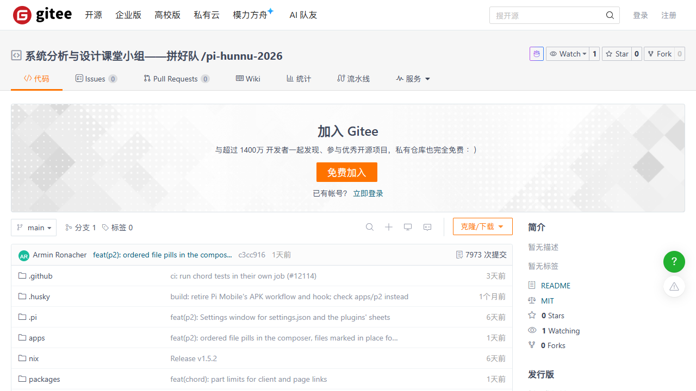

# 实践课3：Pi Agent 源码安装与编译实验报告

- 姓名：刘文佳
- 学号：202430154070
- GitHub 用户名：FaGaoSao
- 实验日期：2026-11-26
- 小组仓库：https://gitee.com/pinhaodui/pi-hunnu-2026

## 一、实验目的

建立 Pi Agent 的本地源码开发环境，能够说明"源码在哪里、依赖装在哪里、构建执行了什么、正在运行哪个版本"。

## 二、任务一：实验准备——检查和安装开发工具

在 PowerShell 中执行版本检查：

```powershell
PS C:\Users\48019\Desktop\程序\pi> node --version
v24.14.0

PS C:\Users\48019\Desktop\程序\pi> npm --version
11.9.0

PS C:\Users\48019\Desktop\程序\pi> git --version
git version 2.53.0.windows.1
```

上次实践课中 Pi 客户端能运行，不代表当前终端一定能找到这三个工具，因此本次重新确认。

| 工具 | 实际版本 | 是否满足要求 |
|------|---------|-------------|
| Node.js | v24.14.0 | 满足，根项目要求 `>=22.19.0`，本机使用 Node.js 24 LTS |
| npm | 11.9.0 | 随 Node.js 24 附带 |
| Git for Windows | 2.53.0.windows.1 | 满足，可执行 `git --version` |

验证 Node.js 可执行：

```powershell
PS C:\Users\48019\Desktop\程序\pi> node -e "console.log('Hello, Node.js!')"
Hello, Node.js!
```


Node.js 版本要求来源：本小组仓库根目录 `package.json` 的 `engines` 字段声明为 `>=22.19.0`（见任务三）。

## 三、任务二：下载课程仓库源码

第二次实践课已完成小组仓库 fork 与源码下载，本次确认现状。

### 3.1 小组组织内仓库

小组 Gitee 组织"拼好队"下的仓库：https://gitee.com/pinhaodui/pi-hunnu-2026



### 3.2 确认源码来源和版本

```powershell
PS C:\Users\48019\Desktop\程序\pi> Get-Location
C:\Users\48019\Desktop\程序\pi

PS C:\Users\48019\Desktop\程序\pi> git remote -v
org     https://gitee.com/pinhaodui/pi-hunnu-2026.git (fetch)
org     https://gitee.com/pinhaodui/pi-hunnu-2026.git (push)
origin  https://github.com/earendil-works/pi.git (fetch)
origin  https://github.com/earendil-works/pi.git (push)

PS C:\Users\48019\Desktop\程序\pi> git branch --show-current
course-main

PS C:\Users\48019\Desktop\程序\pi> git rev-parse HEAD
d981de1229ef899957bbe968bc8dcda02a21f477
```

完整提交编号：`d981de1229ef899957bbe968bc8dcda02a21f477`

`org` 远端指向小组组织内的仓库，后续所有安装和构建命令都在此仓库根目录执行。


## 四、任务三：阅读配置，确认安装与编译的依据

### 4.1 关键文件观察

| 文件或目录 | 观察到的内容 |
|-----------|-------------|
| `README.md` | Development 一节提供 `npm install --ignore-scripts`、`npm run build`、`npm run build:offline`、`npm run check`、`./test.sh`、`./pi-test.sh` |
| `package.json` | `engines.node` 为 `>=22.19.0`；`workspaces` 声明多个包路径；`scripts.build` 为串行命令链；`devDependencies` 含 tsgo、esbuild、biome 等 |
| `package-lock.json` | 锁定依赖版本与依赖关系，是依赖的 ground truth |
| `packages/` | 同一仓库内多个子包：chord、tui、telemetry、ai、agent、session-backends、protocol、client、server、coding-agent、evals |
| `packages/coding-agent/package.json` | CLI 包的 `bin.pi` 指向构建产物；build 脚本为 `build:unbundled` + 打包脚本 |

### 4.2 Node.js 版本要求在哪里

在仓库根目录 `package.json` 的 `engines` 字段：

```json
"engines": {
  "node": ">=22.19.0"
}
```

注意：根项目最低版本不代表每个工作区依赖都只要求同一版本。本机使用 Node.js 24 LTS，高于该要求。

### 4.3 npm run build 实际从哪里读取命令

`npm run build` 本身不执行任何固定编译流程，它读取**项目 package.json 中 `scripts.build` 的定义**。本项目根目录定义为：

```
cd packages/chord && npm run build && cd ../tui && npm run build && ... && cd ../coding-agent && npm run build
```

即：依次进入多个子包，执行各包自己的 `npm run build`。`&&` 表示前一步成功后才继续下一步。

该仓库使用 **npm workspaces** 管理多个包，需从根目录安装依赖、按根目录脚本顺序构建，不要自行给每个子包创建新的依赖锁定文件。


## 五、任务四：安装项目依赖

在包含根 `package.json` 的目录执行：

```powershell
PS C:\Users\48019\Desktop\程序\pi> npm install --ignore-scripts
```

**该命令的作用：**

1. 根据 `package.json` 和 `package-lock.json` 解析、下载并安装依赖；锁文件与声明一致时使用锁定版本。
2. 在本地建立 `node_modules` 等依赖目录，并关联工作区中的本地包。
3. 安装项目需要的库和开发工具，例如编译器（tsgo）、打包工具（esbuild）。
4. `--ignore-scripts` 跳过安装阶段自动触发的生命周期脚本（如 `postinstall`、`prepare`），不影响后续主动执行 `npm run build`。

命令没有 `-g`，安装的是当前项目的依赖，不会把本地修改后的 Pi 自动安装成全局 `pi` 命令。

**安装结果：**

```
added 313 packages, and changed 7 packages in 6m

53 packages are looking for funding
  run `npm fund` for details
```

**警告分析：**

- `npm warn Unknown project config "min-release-age"`：项目 `.npmrc` 中配置了该字段，当前 npm 版本不识别，属配置提示，不影响安装。
- `npm warn deprecated node-domexception@1.0.0`：依赖包已弃用提示，不等同于安装失败。
- `npm warn deprecated prebuild-install@7.1.3`：同上。
- 未出现 `EBADENGINE`，说明 Node.js 24 满足全部依赖的版本要求。
- 本次安装输出未报告漏洞（未出现 `vulnerabilities` 行）。


## 六、任务五：本地编译与构建产物验证（重点：困难与解决）

### 6.1 首次构建 `npm run build` —— 遇到困难

在仓库根目录执行：

```powershell
PS C:\Users\48019\Desktop\程序\pi> npm run build
```

构建依次进入 chord、tui、telemetry、ai 等子包。**在 ai 包失败**，退出码 1：

```
> @earendil-works/pi-ai@0.85.1 check:model-data
> node scripts/check-model-data.ts

Generated model data is valid.
src/providers/kimi-coding.ts(5,36): error TS2307: Cannot find module './kimi-coding.models.ts' or its corresponding type declarations.
src/providers/opencode-go.ts(13,3): error TS2322: Type '...' is not assignable to type 'readonly Model<...>[]'.
  Type 'Model<"google-generative-ai"> & { id: "gemini-4-argon"; provider: "opencode-go"; }' is not assignable to type 'Model<"anthropic-messages" | "openai-completions" | "openai-responses">'.
    Types of property 'api' are incompatible.
      Type '"google-generative-ai"' is not assignable to type '"anthropic-messages" | "openai-completions" | "openai-responses"'.

npm error Lifecycle script `build:offline` failed with error:
npm error code 1
npm error path C:\Users\48019\Desktop\程序\pi\packages\ai
```

**困难描述：**

`npm run build` 的第一步是 `generate-models`，它会联网从 models.dev、OpenRouter、Vercel AI Gateway 拉取最新模型目录，重新生成 `models.generated.ts` 和各 provider 的 shard 文件。

本次实验共遇到**两次失败，原因不同**，分别记录如下。

---

**失败 1：网络不可达，模型目录拉取超时**

第一次执行 `npm run build` 时网络不通，`generate-models` 在第一步 fetch 就超时失败，构建中断在 ai 包：

```
> @earendil-works/pi-ai@0.85.1 generate-models
> node scripts/generate-models.ts --strict

Fetching models from models.dev API...
Fetching models from NVIDIA NIM API...
Failed to fetch NVIDIA NIM models: [TypeError: fetch failed] {
  [cause]: ConnectTimeoutError: Connect Timeout Error (attempted addresses: 99.83.136.103:443, timeout: 10000ms)
}
Failed to load models.dev data: [TypeError: fetch failed] {
  [cause]: ConnectTimeoutError: Connect Timeout Error (attempted addresses: 99.83.136.103:443, timeout: 10000ms)
}
npm error Lifecycle script `generate-models` failed with error:
npm error code 1
```

**原因**：`npm run build` 的首次构建需要联网获取模型目录数据（是模型目录、能力等配置数据，不是下载大模型权重）。当前网络无法访问 models.dev 与 NVIDIA NIM，属于网络环境问题，与本机 Node.js/npm 环境无关。

**当时的处理**：改用 `npm run build:offline` 复用仓库中已有的模型数据，跳过联网步骤。

---

**失败 2：联网成功，但上游模型目录变化与本版本源码不兼容**

网络恢复后重试 `npm run build`，`generate-models` 成功拉到了**更新的模型数据**，但类型检查阶段报错：

1. `kimi-coding` 这个 provider 在新目录中不存在了，生成脚本据此**删除了** `packages/ai/src/providers/kimi-coding.models.ts`，但源码 `kimi-coding.ts` 仍然 `import` 它，于是报 TS2307。
2. 新数据中 `opencode-go` 下出现了 `gemini-4-argon`（api 为 `google-generative-ai`），与该文件声明接受的 api 联合类型不符，报 TS2322。

即：**上游模型目录变化与本版本源码不兼容**，已经不是网络问题，而是"数据比源码新"导致的问题。这也说明 `npm run build` 成功与否受上游目录状态影响，单纯重试并不总能通过。

1. `kimi-coding` 这个 provider 在新目录中不存在了，生成脚本据此**删除了** `packages/ai/src/providers/kimi-coding.models.ts`，但源码 `kimi-coding.ts` 仍然 `import` 它，于是报 TS2307。
2. 新数据中 `opencode-go` 下出现了 `gemini-4-argon`（api 为 `google-generative-ai`），与该文件声明接受的 api 联合类型不符，报 TS2322。

即：**上游模型目录变化与本版本源码不兼容**，不是本机环境问题。

**解决过程：**

先确认生成脚本的副作用范围：

```powershell
PS C:\Users\48019\Desktop\程序\pi> git status --short packages/ai
 M packages/ai/src/models.generated.ts
 D packages/ai/src/providers/kimi-coding.models.ts
```

`models.generated.ts` 被修改、`kimi-coding.models.ts` 被删除。指导书明确说明 **`models.generated.ts` 由脚本生成，不应手工编辑**，因此不能用改源码引用的方式绕过，正确做法是**回到与源码版本匹配的模型数据**。

第 1 步，用 git 恢复这两个受版本控制的文件：

```powershell
PS C:\Users\48019\Desktop\程序\pi> git checkout -- packages/ai/src/providers/kimi-coding.models.ts packages/ai/src/models.generated.ts
```

第 2 步，`src/providers/data/*.json` 在 `.gitignore` 中不受版本控制，无法用 git 恢复，检查时报缺文件：

```powershell
PS C:\Users\48019\Desktop\程序\pi\packages\ai> node scripts/check-model-data.ts
kimi-coding.json is not valid JSON: ENOENT: no such file or directory, open '...\packages\ai\src\providers\data\kimi-coding.json'
Model data is missing or stale. Run `npm run hydrate:model-data` from the repository root.
```

第 3 步，从 npm 上与本源码版本一致的已发布包中提取预生成的模型数据（该包发布时已完成数据生成，二进制内容与 `0.85.1` 源码配套）：

```powershell
PS C:\Users\48019\Desktop\程序\pi> Invoke-WebRequest -Uri "https://registry.npmjs.org/@earendil-works/pi-ai/-/pi-ai-0.85.1.tgz" -OutFile .tmp-pe\pi-ai.tgz -UseBasicParsing
PS C:\Users\48019\Desktop\程序\pi> tar -xzf .tmp-pe\pi-ai.tgz -C .tmp-pe
PS C:\Users\48019\Desktop\程序\pi> Copy-Item .tmp-pe\package\dist\providers\data packages\ai\src\providers\data -Recurse
```

提取到 40 个文件（39 个 provider JSON + 1 个 manifest）。再次校验：

```powershell
PS C:\Users\48019\Desktop\程序\pi\packages\ai> node scripts/check-model-data.ts
Generated model data is valid.
```

数据校验通过，说明恢复的数据与 `models.generated.ts` 结构一致。

第 4 步，改用**复用已有模型数据**的离线构建，避免再次联网覆盖数据：

```powershell
PS C:\Users\48019\Desktop\程序\pi> npm run build:offline
...
> @earendil-works/pi-coding-agent@0.85.1 build
> npm run build:unbundled && node ../../scripts/build-coding-agent-bundle.mjs

> @earendil-works/pi-coding-agent@0.85.1 copy-assets
> shx mkdir -p dist/modes/interactive/theme && shx cp src/modes/interactive/theme/*.json ...

Built packages\coding-agent\dist\bundle (51 files, 7.5 MiB)

PS C:\Users\48019\Desktop\程序\pi> $LASTEXITCODE
0
```

构建成功，退出码 0。

**经验总结：**

- `npm run build` 会**主动联网更新模型目录**，属预期行为（模型目录数据，不是大模型权重）；这带来两类失败：网络不通（失败 1）、上游目录变化与本版本源码不兼容（失败 2）。
- 出错时应先看**是哪个子包、哪一行**，区分"网络问题""环境问题""上游数据变化导致的类型不匹配"。本实验两次失败的日志完全不同，处理方式也不同。
- 受版本控制的文件可用 git 恢复；被 gitignore 的生成数据需另行补齐。
- 数据已准备好且仍有效时，用 `npm run build:offline` 复用数据，不重复联网。


### 6.2 检查并运行构建产物

```powershell
PS C:\Users\48019\Desktop\程序\pi> Test-Path .\packages\coding-agent\dist\bundle\cli.js
True

PS C:\Users\48019\Desktop\程序\pi> node .\packages\coding-agent\dist\bundle\cli.js --version
0.85.1

PS C:\Users\48019\Desktop\程序\pi> node .\packages\coding-agent\dist\cli.js --version
0.85.1
```

入口文件存在，通过本地路径运行得到版本号 `0.85.1`，与源码版本（package.json version）一致。该入口来自 CLI 包的 `bin.pi` 配置。

`dist` 保存构建产物：以后修改程序应修改 `src` 下的源码再重新构建；直接修改 `dist` 中的文件，可能在下次构建时被覆盖。


### 6.3 后续重新构建

首次构建成功、模型目录数据已准备好且仍有效后，可使用：

```powershell
npm run build:offline
```

它仍会重新编译相关包，但复用已有模型目录数据。本次实验后续（实践课4加日志）重新编译即使用该命令。

## 七、任务六：启动本地源码版本并完成一次会话

### 7.1 先验证源码入口

```powershell
PS C:\Users\48019\Desktop\程序\pi> .\pi-test.bat --version
0.85.1
```

该脚本名称包含 test，但它是**运行本地源码的入口**，不是执行整个项目测试套件。当前版本的 `.bat` 调用 `.ps1`，由 Node.js 加载源码解析器并运行 `packages/coding-agent/src/cli.ts`。

### 7.2 启动交互界面并完成会话

```powershell
PS C:\Users\48019\Desktop\程序\pi> .\pi-test.bat
```

本次使用该命令验证本地源码。直接输入 `pi` 可能启动第一次实践课安装的全局版本，无法单独证明运行的是刚下载的源码。

本地源码版默认与已安装的 Pi 共用当前用户的配置目录 `~/.pi/agent`，因此第一次实践课已完成登录且凭据仍有效时，运行 `.\pi-test.bat` 后无需再次 `/login`。这表示复用了用户配置，并不表示运行的是全局安装版本。

发送的提示词：

> 请用一句话说明源码和编译产物的区别。只回答问题，不修改文件。

模型实际回复（要点）：源码是开发者编写的、可读可修改的原始代码；编译产物是源码经构建工具转换后生成的、供程序直接运行的机器可执行形式，通常不应手工修改。


## 八、报告说明

### 本次如何确保运行的是本地源码？

三点证据：

1. 启动命令是 `.\pi-test.bat`（进而调用 `pi-test.ps1`），脚本内部由 Node.js 直接加载 `packages/coding-agent/src/cli.ts`，绕开全局安装的 `pi`。
2. `.\pi-test.bat --version` 输出 `0.85.1`，与本地 `package.json` 的 version 一致。
3. 实践课4中修改 `packages/agent/src/agent-loop.ts` 加入的两行 `[P4]` 日志，在重新构建后由本地源码版本输出，直接证明运行的是本地源码构建结果。

### 源码入口与 dist/bundle/cli.js 入口分别适合什么场景？

| 入口 | 适用场景 | 原因 |
|------|---------|------|
| `.\pi-test.bat`（运行 `src/cli.ts`） | 开发调试、验证刚修改的源码、需要即时看到改动效果 | 直接由 Node.js 加载 TypeScript 源码，无需先完整构建；启动路径短，便于定位问题 |
| `node .\packages\coding-agent\dist\bundle\cli.js` | 验证构建产物、接近发布形态的运行、确认编译无遗漏 | 运行的是打包后的产物，文件数少（51 个文件）、体积约 7.5 MiB，与用户实际安装运行的形态一致 |

两者版本号相同，但前者验"源码对不对"，后者验"编译出来能不能跑"。

## 九、遇到的问题汇总

| 问题 | 现象 | 原因 | 解决 |
|------|------|------|------|
| 失败 1：`npm run build` 联网超时 | `generate-models` 报 `ConnectTimeoutError`（models.dev / NVIDIA NIM 均超时），`npm error code 1` | 首次构建需联网获取模型目录数据，当时网络无法访问上述站点 | 改用 `npm run build:offline` 复用已有模型数据 |
| 失败 2：重试时上游目录与源码不兼容 | TS2307 找不到 `kimi-coding.models.ts`；TS2322 `opencode-go` 类型不匹配 | 网络恢复后 `generate-models` 拉到新模型目录，删除了源码仍引用的 provider shard，并引入本版本不支持的 api 类型 | 回退受版本控制的生成文件，从 npm 同版本包补齐被 gitignore 的数据文件，再用 `npm run build:offline` |
| 模型数据目录不受版本控制 | `check:model-data` 报 `kimi-coding.json` 缺失 | `packages/ai/src/providers/data/` 在 `.gitignore` 中 | 从 `@earendil-works/pi-ai@0.85.1` 已发布包提取（40 个文件） |
| PowerShell 不支持 `&&` | 命令解析报错 | 当前 PowerShell 版本不支持 `&&` 链式操作符 | 改用 `;` 分隔或分步执行 |

## 十、实验总结

本次实验建立了 Pi 的本地源码开发环境。与第一次实践课（使用安装好的客户端）相比，本次能明确回答四个问题：

- **源码在哪里**：小组组织仓库 `https://gitee.com/pinhaodui/pi-hunnu-2026`，本地位于 `C:\Users\48019\Desktop\程序\pi`，提交编号 `d981de1229ef899957bbe968bc8dcda02a21f477`。
- **依赖装在哪里**：仓库根目录 `node_modules`（以及各工作区的 node_modules），由 `npm install --ignore-scripts` 从根目录统一安装。
- **构建执行了什么**：根 `scripts.build` 是串行命令链，依次进入 10 个子包执行各自的 build（TypeScript 编译产物到各自 `dist/`，ai 包额外生成模型目录，coding-agent 额外打包 bundle）。
- **正在运行哪个版本**：`0.85.1`，由 `.\pi-test.bat --version` 与本地路径运行 `dist/bundle/cli.js --version` 双重确认。

最有价值的收获是两次构建失败的处理过程。两次日志完全不同：第一次是纯网络问题（`ConnectTimeoutError`），第二次是上游模型目录跑到了源码前面（类型不匹配）。顺着 `git status` 能看出第二次失败是联网更新模型目录的副作用，进而区分出"应当回退的受版本控制文件"和"需要另外补齐的被忽略数据文件"。这个过程比单纯让构建跑通更能说明构建脚本到底动了什么，也说明了为什么离线构建 `npm run build:offline` 值得作为一个独立命令存在。
