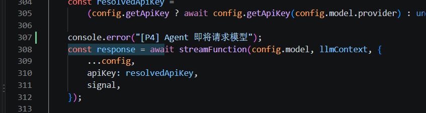
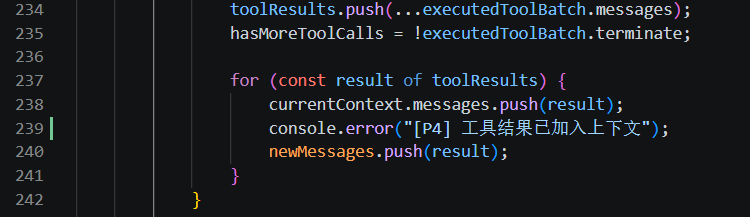
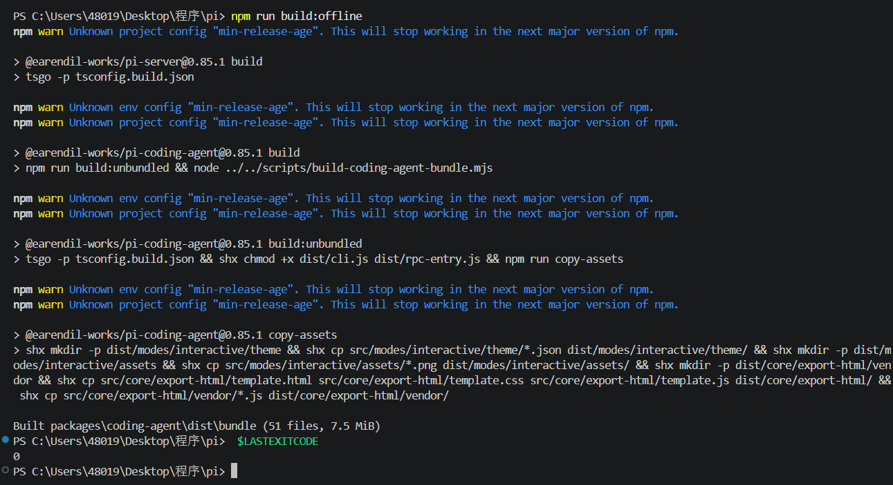
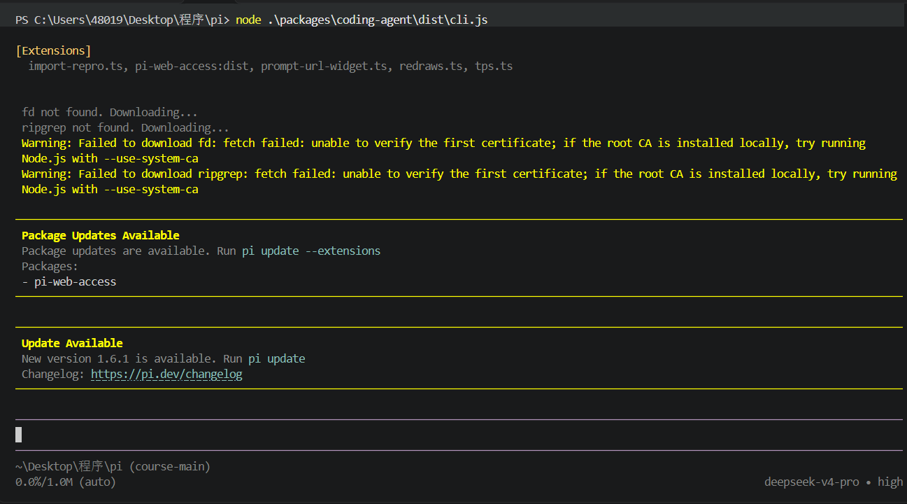
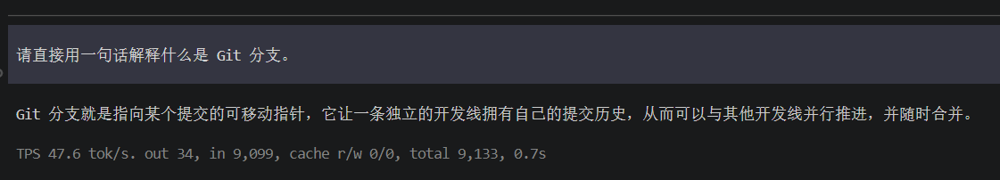
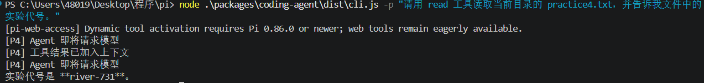
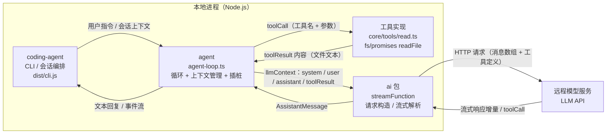

# 实践课 4：Agent 会话流程插桩观测报告

| 项目 | 内容 |
| --- | --- |
| 姓名 | 刘文佳 |
| 学号 | 202430154070 |
| GitHub 用户名 | FaGaoSao |
| 日期 | 2026-11-26 |
| 小组仓库 | https://gitee.com/pinhaodui/pi-hunnu-2026 |

实验目标：在 `packages/agent/src/agent-loop.ts` 中加入两处 `console.error` 插桩，用编译产物跑一次「直接问答」和一次「读取文件」的会话，通过日志顺序观察 Agent 循环被模型调用和工具结果分别驱动了几次。

---

## 一、插桩点说明

插桩文件：`packages/agent/src/agent-loop.ts`。

指导书给出的行号与本章源码的实际行号不一致：本地这份源码的 `agent-loop.ts` 共 805 行，函数与分支的排布与指导书版本不同，因此两处插桩都通过搜索目标语句定位，最终落在第 **307** 行和第 **239** 行。

### 插桩点 1：模型请求之前（第 307 行）

定位语句：搜索 `const response = await streamFunction(`。该语句位于 `streamAssistantResponse()` 内（函数起始于第 280 行），在组装完 `llmContext`、解析完 API Key 之后。插桩写在它上方，表示「Agent 即将把上下文发给模型」。

修改前（第 303–308 行）：

```ts
// Resolve API key (important for expiring tokens)
const resolvedApiKey =
	(config.getApiKey ? await config.getApiKey(config.model.provider) : undefined) || config.apiKey;

const response = await streamFunction(config.model, llmContext, {
```

修改后（第 303–312 行）：

```ts
// Resolve API key (important for expiring tokens)
const resolvedApiKey =
	(config.getApiKey ? await config.getApiKey(config.model.provider) : undefined) || config.apiKey;

console.error("[P4] Agent 即将请求模型");
const response = await streamFunction(config.model, llmContext, {
	...config,
	apiKey: resolvedApiKey,
	signal,
});
```



### 插桩点 2：工具结果入上下文之后（第 239 行）

定位语句：搜索 `currentContext.messages.push(result);`。该语句位于主循环的 `for (const result of toolResults)` 之内（循环为第 237–241 行），工具结果被写入 `currentContext.messages` 之后立即插桩，表示「工具结果已经进入上下文，下一轮请求会带上它」。

修改前（第 237–241 行）：

```ts
for (const result of toolResults) {
	currentContext.messages.push(result);
	newMessages.push(result);
}
```

修改后（第 237–241 行）：

```ts
for (const result of toolResults) {
	currentContext.messages.push(result);
	console.error("[P4] 工具结果已加入上下文");
	newMessages.push(result);
}
```



两条日志都写在 `console.error`（stderr），不是 `console.log`（stdout）。

---

## 二、编译与启动记录

### 编译

首次执行 `npm run build` 失败，失败点在 `ai` 包的模型目录生成环节：先把联网拉取的最新模型元数据写回源码，导致 `TS2307`（找不到 `kimi-coding.models.ts`）和 `TS2322`（`opencode-go` 的 api 字段类型不匹配）两个错误，与本实验改动无关。因为实验只需要本地的 agent 循环插桩生效，改为离线构建：

```
npm run build:offline
```

构建结束输出：

```
Built packages\coding-agent\dist\bundle (51 files, 7.5 MiB)
```

`$LASTEXITCODE = 0`，构建成功。



### 启动

从仓库根目录启动编译产物（不是 `npm run dev`，走的是 dist 里的 CLI）：

```
node .\packages\coding-agent\dist\cli.js
```



实验用的输入文件内容只有一行：

```
代号：river-731
```

---

## 三、两次会话对照

| 维度 | 会话 A（直接问答） | 会话 B（读取文件） |
| --- | --- | --- |
| 输入指令 | 请直接用一句话解释什么是 Git 分支。 | 请用 read 工具读取当前目录的 practice4.txt，并告诉我文件中的实验代号。 |
| 是否调用工具 | 否 | 是，调用 `read` 读取 `practice4.txt` |
| `[P4]` 日志（按顺序） | 1. `[P4] Agent 即将请求模型` | 1. `[P4] Agent 即将请求模型`<br>2. `[P4] 工具结果已加入上下文`<br>3. `[P4] Agent 即将请求模型` |
| 最终回复 | Git 分支是指向某个提交的可移动指针，它让一条独立的开发线拥有自己的提交历史，从而可以与其他开发线并行推进，并随时合并。 | 实验代号是 **river-731**。 |
| 进入几轮模型调用 | 1 轮 | 2 轮 |





日志条数与循环次数严格对应：第 307 行的日志每调用一次模型就打印一次，第 239 行的日志每有一个工具结果写入上下文就打印一次。会话 A 只有一条模型请求日志，说明模型一次回答完就结束；会话 B 的两条模型请求日志中间夹着一条工具结果日志，说明中间发生过一次真实的工具执行与结果回填。

---

## 四、结合会话 B 的日志回答问题

**1. 谁实际读了文件？**

实际执行文件读取的是 `read` 工具，不是模型。模型在第 1 轮的回复里只是产出了一个 `toolCall`（工具名 `read`、参数 `path = practice4.txt`），这个调用由 `executeToolCalls()` 派发给工具实现执行。工具实现位于 `packages/coding-agent/src/core/tools/read.ts`，它通过 `fs/promises` 的 `readFile` 做缓冲读取，取到文件内容后再交给模型：`read.ts:4` 引入 `readFile as fsReadFile`，`read.ts:46` 把它挂到默认读操作上，`read.ts:129` 在文本分支里真正调用 `ops.readFile(absolutePath)` 得到 `Buffer`，并 `toString("utf-8")` 解码。

模型本身没有文件系统权限，只能决定「去读哪个文件」，读的动作发生在本地进程里。

**2. 下一轮模型请求多带了什么？**

多带了一条工具结果消息。第 237–241 行的循环把工具结果 `push` 进 `currentContext.messages`，该消息由 `createToolResultMessage()`（`agent-loop.ts:786`）构造，字段为 `role: "toolResult"`（`agent-loop.ts:788`），并携带 `toolCallId`（与上一轮 `toolCall` 的 id 对应）、`toolName`、`content`（即文件文本）、`isError`、`timestamp`。

因此第 2 轮请求的上下文结构是：`system` + `user`（原始指令）+ `assistant`（第 1 轮含 toolCall 的回复）+ `toolResult`（文件内容）。模型在第 2 轮看到的不是文件系统，而是被塞进对话历史的这段文本，所以它能直接复述出 `river-731`。`toolCallId` 的存在让服务端能把这条结果与发起调用的那次 `toolCall` 配对，模型据此知道「我要的内容拿到了」。

---

## 五、四者关系简图



箭头方向即数据流方向。要点：`agent` 是唯一的循环控制者，工具结果不直接返回给用户，而是先回到 `agent` 的上下文，再由 `agent` 发起下一次模型请求；`ai` 只负责协议层（请求构造与流式解析）；`coding-agent` 负责把 `agent` 的事件渲染成交互界面并落盘会话。

---

## 六、关于 `[P4]` 日志的输出位置

两处插桩都使用 `console.error`，写入 **stderr**，而 Pi 的交互界面（TUI）同时也在向终端绘制自己的输出。两者共用同一个终端，日志行会**穿插在界面输出之间**，表现为：

- 日志可能插在助手回复文字中间，或覆盖到界面重绘区域，看起来像界面被破坏；
- 复制终端内容时，界面控制字符与日志行混在一起，不容易分离；
- 输出顺序上，stderr 默认不缓冲、stdout/TUI 有重绘节奏，二者交错顺序不保证与代码执行顺序完全一致，但**同一个流内** `[P4]` 之间的先后顺序是可靠的。

处理方式：看日志时序时以 `[P4]` 行出现的先后为准，不要以界面渲染位置为准；需要干净日志时把 stderr 重定向到文件，例如 `node .\packages\coding-agent\dist\cli.js 2> p4.log`。另外，插桩写日志本身不改变循环行为——`console.error` 无返回值、无副作用，A/B 两次会话的轮数与工具调用行为因此是可信的观测结果。

---

## 七、结论

- 模型调用次数由 `agent-loop.ts` 的循环次数决定：一次模型请求对应一轮「模型思考」，工具结果回填上下文后循环继续，就会产生下一次请求。
- 会话 A 证明纯问答不触发工具路径，只有 1 条模型请求日志。
- 会话 B 证明 `read` 工具承担了真实 I/O，模型只做决策；跨轮传递文件内容的载体是 `role: "toolResult"` 的消息，而非模型记忆。
- 两处插桩连起来即可把「模型调用—工具执行—结果回填」的闭环可视化，是理解 Agent 循环最小充分的手段。
