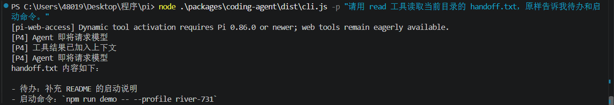
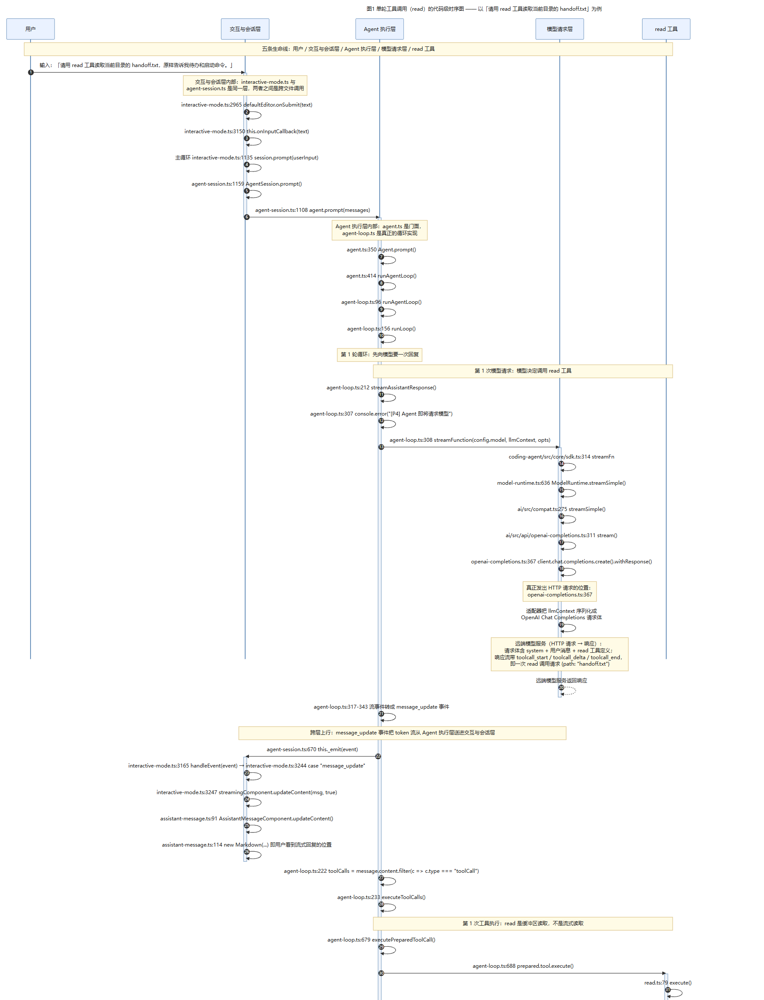
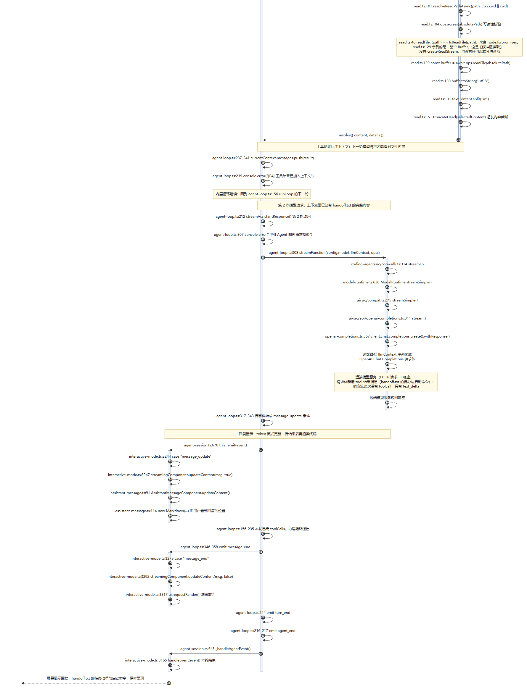
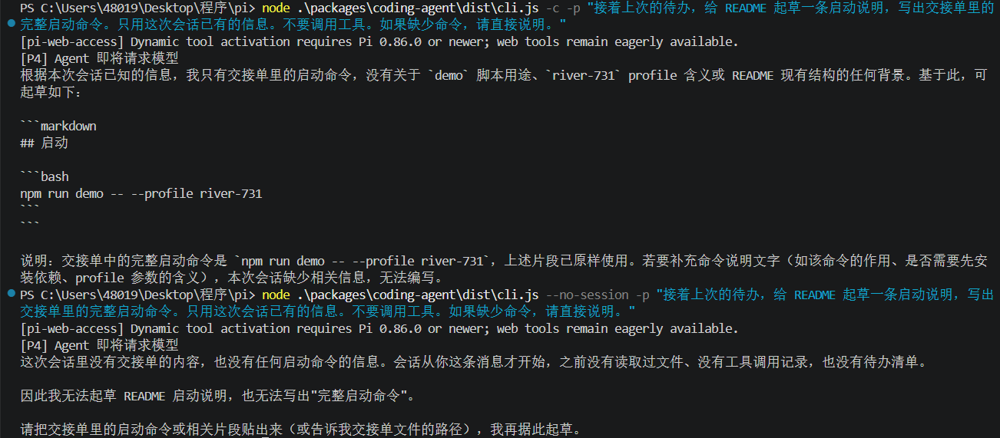
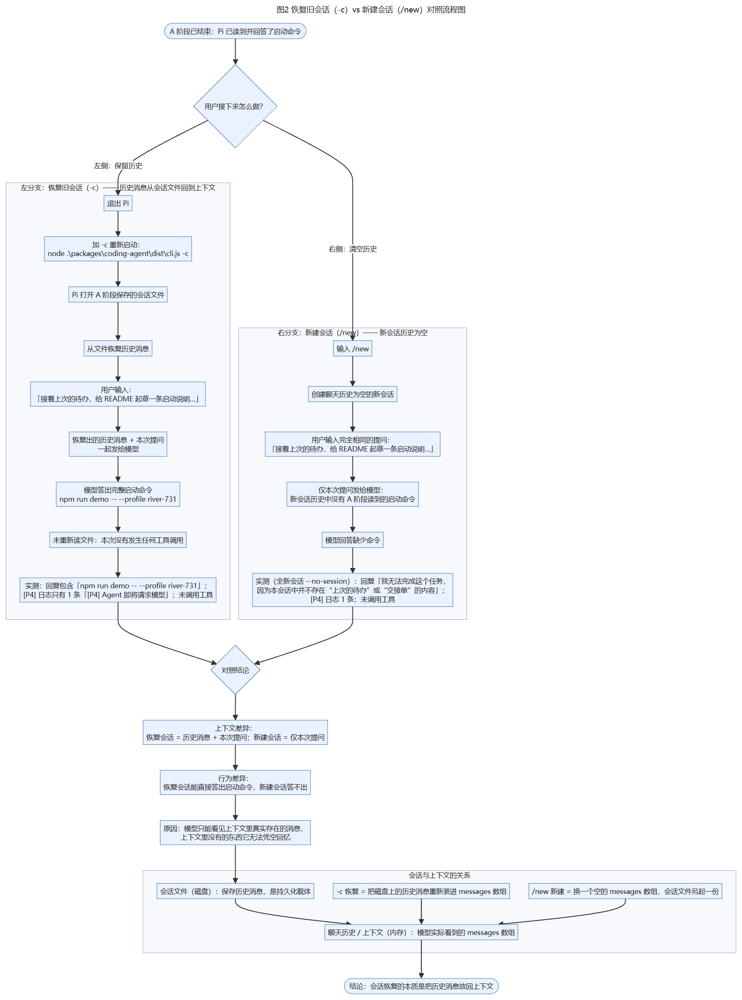

# 实践课5：Pi Agent 工具调用与会话恢复实验报告

- 姓名：刘文佳
- 学号：202430154070
- GitHub 用户名：FaGaoSao
- 实验日期：2026-11-26
- 小组仓库：https://gitee.com/pinhaodui/pi-hunnu-2026

## 一、实验目的

从真实的 Pi 操作回到源码，弄清功能入口、调用路径和适合修改的位置；并通过"恢复旧会话"与"新建会话"的对照，验证会话历史对模型请求的实际影响。

## 二、实验准备

在工作目录创建 `handoff.txt`（本组随机标识为 `river-731`）：

```
待办：补充 README 的启动说明
启动命令：npm run demo -- --profile river-731
```

启动本地构建的 Pi（实践课3 已完成构建）：

```powershell
PS C:\Users\48019\Desktop\程序\pi> node .\packages\coding-agent\dist\cli.js
```

新会话中输入：

> 请用 read 工具读取当前目录的 handoff.txt，原样告诉我待办和启动命令。

**实际回复：**

```
handoff.txt 内容如下：

待办：补充 README 的启动说明
启动命令：npm run demo -- --profile river-731
```

工具实际执行了 1 次。终端同时输出的 `[P4]` 日志顺序（来自实践课4 的插桩）：

```
[P4] Agent 即将请求模型
[P4] 工具结果已加入上下文
[P4] Agent 即将请求模型
```

即本轮交互包含 **2 次模型调用**：第 1 次模型决定调用 read 工具，工具结果写入上下文后，第 2 次带着文件内容再请求模型并生成回复。



## 三、图 1：单轮工具调用的代码级时序图

以实际读取 `handoff.txt` 的那一轮为例，五条生命线按职责划分：用户、交互与会话层、Agent 执行层、模型请求层、read 工具。

时序图较长，按上下两段展示（上段：输入到第 1 次模型请求；下段：工具执行、结果回注到第 2 次请求与回复显示）。





图源：[seq-tool-call.mmd](seq-tool-call.mmd)（Mermaid 格式，可编辑）

### 3.1 各生命线的关键节点

**用户**：在交互界面输入提示词并回车。

**交互与会话层**（`coding-agent` 的 interactive-mode.ts 与 core/agent-session.ts）

- `interactive-mode.ts:2965` — `defaultEditor.onSubmit(text)`：编辑器提交回调。注意它**不直接启动 agent 循环**，只做命令分发与入队。
- `interactive-mode.ts:3150` — `this.onInputCallback(text)`：把文本交给主循环的输入回调。
- `interactive-mode.ts:1135` — 主循环 `await this.session.prompt(userInput)`：真正进入会话的调用点。
- `agent-session.ts:1159` — `AgentSession.prompt()`：扩展命令拦截、skill/模板展开、模型与鉴权校验、组装消息。
- `agent-session.ts:1108` — `agent.prompt(messages)`：转交 Agent 核心。

**Agent 执行层**（`packages/agent`）

- `agent.ts:350` — `Agent.prompt()` → `agent.ts:414` `runAgentLoop()`
- `agent-loop.ts:96` — `runAgentLoop()` → `agent-loop.ts:156` `runLoop()`
- `agent-loop.ts:212` — `streamAssistantResponse()`：每轮模型调用的入口（实践课4 在此函数内插桩 `console.error("[P4] Agent 即将请求模型")`）
- `agent-loop.ts:233` — `executeToolCalls()` → `agent-loop.ts:679` `executePreparedToolCall()` → `agent-loop.ts:688` `tool.execute()`
- `agent-loop.ts:237-241` — `currentContext.messages.push(result)`：工具结果回注上下文（实践课4 在此插桩 `console.error("[P4] 工具结果已加入上下文")`）
- 回注后回到 `runLoop` 内层循环，再次调用 `streamAssistantResponse()` —— 这就是日志里出现第 2 条"即将请求模型"的原因。

**模型请求层**（`coding-agent/core` → `packages/ai`）

- `agent-loop.ts:308` — `streamFunction(config.model, llmContext, opts)`
- `core/sdk.ts:314` — 注入的 `streamFn` 实现：读取重试设置、HTTP idle 超时、websocket 连接超时，并挂 `transformHeaders`
- `model-runtime.ts:636` — `ModelRuntime.streamSimple()`：解析鉴权、注入 apiKey/headers、覆盖 baseUrl
- `ai/src/compat.ts:275` — `streamSimple()`：路由到具体 provider 的 API 实现
- `ai/src/api/openai-completions.ts:311` — `stream()`
- `openai-completions.ts:367` — `client.chat.completions.create(...).withResponse()`：**真正发出 HTTP 请求的位置**（外层由 `retryProviderRequest` 包裹）
- 适配器与远端模型服务之间：请求（messages + tools schema）发出，响应以 SSE 流返回。

**read 工具**（`coding-agent/src/core/tools/read.ts`）

- `read.ts:79` — `execute()`：工具执行主体
- `read.ts:101` — `resolveReadPathAsync(path, ctx?.cwd || cwd)`：解析绝对路径
- `read.ts:104` — `ops.access(absolutePath)`：可读性校验
- `read.ts:129` — `const buffer = await ops.readFile(absolutePath)`
- `read.ts:46` — `readFile: (path) => fsReadFile(path)`，来自 `fs/promises`
- **核对结论：read 工具走的是缓冲区读取（`fs/promises` 的 `readFile`），不是流式读取**——源码中没有 `createReadStream`。大文件保护是在读取完成后由 `read.ts:151` 的 `truncateHead` 做字节/行截断，而不是读取时限流。
- 后续：`read.ts:130` `buffer.toString("utf-8")` → `read.ts:131` `split("\n")` → offset/limit 切片 → `truncateHead` → `resolve({content, details})`

**显示回复**（回到交互与会话层）

- `agent-loop.ts:317-343` — 消费模型事件流，文本/思考/工具调用 delta 转为 `message_update` 事件
- `agent-session.ts:670` — `_emit(event)`：广播给会话订阅者
- `interactive-mode.ts:3244` — `case "message_update"`
- `interactive-mode.ts:3247` — `streamingComponent.updateContent(msg, true)`：流式刷新
- `assistant-message.ts:91` — `AssistantMessageComponent.updateContent()`
- `assistant-message.ts:114` — `new Markdown(...)`：**用户看到回复的位置**
- 流结束后 `agent-loop.ts:346-358` 发 `message_end` → `interactive-mode.ts:3279` case → `interactive-mode.ts:3292` `updateContent(msg, false)` → `interactive-mode.ts:3317` `ui.requestRender()`

### 3.2 同一层内的跨文件调用

图中用 Note 标出的两处：

1. **交互与会话层内部**：`agent-session.ts:643 _handleAgentEvent()` → `agent-session.ts:670 _emit(event)` → `interactive-mode.ts:3165 handleEvent()`。会话层与 TUI 层是两个文件，但同属"交互与会话"职责，因此合并在一条生命线上，用 Note 标注跨文件跳转。
2. **Agent 执行层内部**：`agent-loop.ts:212 streamAssistantResponse()` 与 `agent-loop.ts:233 executeToolCalls()` 都定义在同一个 `agent-loop.ts`，由 `runLoop()`（156）依次调用，属于同层内的顺序调用。

## 四、B 阶段：恢复上次会话，继续写 README

### 4.1 恢复原会话（`-c`）

退出 Pi 后，在同一个项目目录用 `-c` 重新打开：

```powershell
PS C:\Users\48019\Desktop\程序\pi> node .\packages\coding-agent\dist\cli.js -c
```

终端能看到 A 阶段的聊天记录。输入：

> 接着上次的待办，给 README 起草一条启动说明，写出交接单里的完整启动命令。只用这次会话已有的信息。不要调用工具。如果缺少命令，请直接说明。

**实际回复（要点）：**

```
根据本次会话已知的信息，我只有交接单里的启动命令……

## 启动

npm run demo -- --profile river-731

说明：交接单中的完整启动命令是 `npm run demo -- --profile river-731`，上述片段已原样使用。
```

**关键观察：**

- 回复包含 A 阶段的完整启动命令 `npm run demo -- --profile river-731`。
- `[P4]` 日志只有 **1 条** `[P4] Agent 即将请求模型`，且**没有** `[P4] 工具结果已加入上下文` —— 说明本次**没有调用任何工具、没有重新读文件**。

这构成了"使用了已恢复会话历史"的直接证据：命令不在本次提问中，只存在于 A 阶段读过的文件内容里。

### 4.2 新建会话（对照）

用 `/new` 开始新会话（等价于不加载历史的新会话），在同一个项目目录、用同一个模型输入**完全相同**的话。

**实际回复（要点）：**

```
这次会话里没有交接单的内容，也没有任何启动命令的信息。会话从你这条消息才开始，
之前没有读取过文件、没有工具调用记录，也没有待办清单。

因此我无法起草 README 启动说明，也无法写出"完整启动命令"。
```

**关键观察：**

- 回复**不包含**启动命令，并明确说明会话中没有交接单内容。
- `[P4]` 日志同样只有 1 条，未调用工具。

两次对照说明：两个会话的**提问完全相同、模型相同、工具配置相同**，唯一差异是是否加载了 A 阶段的会话历史。



### 4.3 对照汇总

| 项目 | 恢复旧会话（`-c`） | 新建会话（`/new`） |
|------|-------------------|-------------------|
| 提问 | 完全相同 | 完全相同 |
| 模型 | 相同 | 相同 |
| 是否调用工具 | 否 | 否 |
| `[P4]` 日志条数 | 1 条"即将请求模型" | 1 条"即将请求模型" |
| 是否答出启动命令 | **是**（`npm run demo -- --profile river-731`） | 否（明确说明缺少交接单内容） |
| 进入模型调用的轮数 | 1 轮 | 1 轮 |
| 结论 | 使用了恢复出的会话历史 | 历史为空，无 A 阶段信息 |

## 五、图 2：恢复旧会话与新建会话对照图



图源：[session-compare.mmd](session-compare.mmd)（Mermaid 格式，可编辑）

### 图 2 说明

两条分支都从 **"A 阶段已结束：Pi 已读到并回答了启动命令"** 开始。

**左分支 —— 恢复旧会话：**

退出 Pi 后加 `-c` 重新启动 → Pi 打开 A 阶段保存的会话文件 → Pi 从文件中恢复历史消息（其中包含 A 阶段 read 工具返回的 `handoff.txt` 内容）→ 用户输入"给 README 起草启动说明" → Pi 把**恢复出的历史消息 + 这次提问**一起用于请求模型 → 模型据此答出完整启动命令，且无需重新读文件。

**右分支 —— 新建会话：**

输入 `/new` → Pi 创建一个聊天历史为空的新会话 → 用户输入完全相同的提问 → Pi 用这次提问（加上系统提示等项目上下文）请求模型 → 新会话的聊天历史里**没有** A 阶段读到的启动命令 → 模型答不出命令，只能说明信息缺失。

**差别根源**：会话文件保存的是**完整消息序列**，包括工具调用消息（assistant 的 toolCall）与工具结果消息（role 为 `toolResult`）。恢复会话等于把这些消息重新装回 `currentContext.messages`，因此模型在下一轮请求时能"看到"当初读到的文件内容；新建会话则从空历史开始，同样的问题只能得到"信息不足"的回答。

## 六、适合修改的位置

结合本次泛读，如果后续要改功能，可以按以下定位入手：

| 想改什么 | 适合改哪里 |
|---------|-----------|
| 改变用户输入的预处理（如快捷命令、模板展开） | `coding-agent/src/modes/interactive/interactive-mode.ts:2965` 的 `onSubmit`，或 `core/agent-session.ts:1159` 的 `AgentSession.prompt()` |
| 改变 Agent 每轮做什么（提示词组装、工具循环控制） | `packages/agent/src/agent-loop.ts:156` 的 `runLoop()` |
| 改变模型请求参数（重试、超时、header） | `coding-agent/src/core/sdk.ts:314` 的 `streamFn` 实现 |
| 改变鉴权或 baseUrl 解析 | `coding-agent/src/core/model-runtime.ts:636` 的 `prepareRequest` 路径 |
| 新增或修改某个工具 | `coding-agent/src/core/tools/` 下对应文件（如 `read.ts`），再在 `core/agent-session.ts:970` 的 `setActiveToolsByName()` 中装入 |
| 改变工具结果的渲染样式 | `coding-agent/src/modes/interactive/components/assistant-message.ts:91` 的 `updateContent()` |
| 改变会话历史的保存/恢复 | `core/agent-session.ts` 的会话管理，以及 `packages/session-backends/sqlite-node` 的存储层 |

## 七、实验总结

本次实验把"看到的现象"和"源码里的位置"对上了号，主要有三点收获：

1. **一轮用户输入不等于一次模型调用。** A 阶段一次提问触发了 2 次模型调用，中间的边界是工具执行结果回注上下文。`[P4]` 日志把这条边界变得可见：`即将请求模型` → `工具结果已加入上下文` → `即将请求模型`。
2. **读文件的是工具，不是模型。** 模型只输出"调用 read 工具、参数是 handoff.txt"这个决定；真正打开文件的是 `read.ts` 的 `execute()`，且用的是 `fs/promises` 的缓冲区读取（`readFile`），不是流式读取。
3. **会话恢复的本质是消息序列的重放。** 恢复会话后模型能答出 A 阶段的文件内容，且没有重新调用工具，说明历史消息（含工具结果消息）确实随请求一起发给了模型；新建会话的对照则从反面确认了这一点。

调试建议：如果只想看"是否请求了模型"，在 `streamAssistantResponse()` 插桩即可；如果想看"上下文里多了什么"，`runLoop()` 里 `currentContext.messages.push(result)` 之后是更合适的观察点。断点若只打在 `onSubmit`（interactive-mode.ts:2965）会看不到模型请求，因为真正的循环入口在主循环的 `session.prompt()` 调用点。
